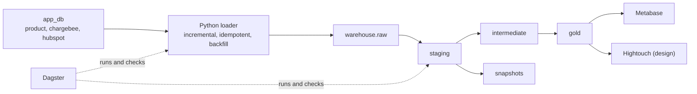

# Goldmine

An end-to-end data platform for a made-up SaaS company, built to practise the whole path from messy sources to trusted metrics: ingestion, a layered dbt project, tests, history, orchestration, CI and dashboards.

The company sells a customer messaging product. Three systems hold its data: the **product database** (workspaces, users, messages), **Chargebee** (billing) and **HubSpot** (sales). The sources are deliberately messy, like real ones, and the project is built around finding and handling that mess.

Built with Claude Code.



PostgreSQL 16 plays both the sources (`app_db`) and the warehouse (`warehouse`, standing in for Redshift). `docs/redshift.md` covers what changes on a real Redshift cluster.

## What is in it

| Area | What |
|---|---|
| Sources | 18 months of generated history: trials, upgrades, downgrades, seat changes, pauses, cancellations, reactivations, a Chargebee events log, 1.5 million messages. More than a dozen kinds of planted mess. `sources/` |
| Ingestion | Full load, then incremental on `updated_at` with a lookback window. Replace-by-id, so any run can be repeated safely. Backfill by date range. New source columns are added automatically. A run log. A reconciliation script that compares source with raw. `ingestion/` |
| dbt | 11 staging, 5 intermediate and 8 gold models, one snapshot, 123 tests, source freshness on the run log, column documentation and a lineage graph. `goldmine_dbt/` |
| Metrics | MRR with movements (new, expansion, contraction, churned, paused, resumed, reactivated), logo churn, revenue churn, net and gross revenue retention, active workspaces. Defined once. `docs/metrics.md` |
| Incremental model | Daily workspace activity, built from message arrival time so late data corrects the right day. Verified equal to a full rebuild. |
| History | The events log rebuilds monthly state back to the start. A snapshot records versions from its first run. |
| Orchestration | Dagster: loader and dbt as assets in dependency order, a daily schedule, an hourly freshness check, reconciliation checks, a failure alert. `orchestration/` |
| CI | GitHub Actions on every pull request: generates data, loads it twice, builds and tests dbt twice, checks freshness, uploads the dbt docs. `.github/workflows/ci.yml` |
| Dashboard | Metabase, set up by script, with a SaaS metrics dashboard on the gold tables. `scripts/metabase_setup.py` |
| Redshift | Terraform for the cluster, S3 staging, IAM and cost limits; access roles; table design; load and maintenance SQL. `terraform/`, `redshift/` |
| Reverse ETL | A tested dbt model for Hightouch and the sync design. `hightouch/`, `docs/hightouch.md` |
| Failure drills | Seven staged failures, run for real, with the symptom, root cause and fix recorded. `INCIDENTS.md`, `sources/simulate_changes.py` |
| Runbook | What to do for each kind of failure. `docs/runbook.md` |

## What was actually run, and what was not

| Verified by running it | Written as a design, not run |
|---|---|
| Generator, loader, reconciliation, backfill, schema drift handling | Redshift SQL in `redshift/` (no cluster) |
| All dbt models, tests, snapshot, docs | Terraform apply (it passes `tofu validate` and `tofu fmt`, but there is no AWS account) |
| Dagster jobs, checks and the failure alert, end to end | The Hightouch sync (needs a hosted account; the model it reads is built and tested) |
| Metabase setup and every dashboard query | The `redshift` dbt target |
| The CI steps, on small data, against throwaway databases | The GitHub Actions run itself, until it runs on GitHub |

Current result of `dbt build` on the full local dataset: **138 passed, 10 warnings, 0 errors**. The 10 warnings are known source defects, each with the reason written next to the test.

## Run it

Needs Podman (or Docker) with compose, and Python 3.12.

```bash
podman-compose up -d                         # PostgreSQL on :5433, Metabase on :3030
python3.12 -m venv .venv
.venv/bin/pip install -r requirements.txt

make schema generate                         # create the source tables and fill them with history
make load                                    # source -> warehouse.raw
make build                                   # dbt: models, snapshot, tests
.venv/bin/python scripts/metabase_setup.py   # dashboard at http://localhost:3030

make dagster                                 # orchestration UI at http://localhost:3001
make docs                                    # dbt docs and the lineage graph
make pytest                                  # tests for the orchestration code
```

Run `make load` again and nothing changes. Try the drills:

```bash
.venv/bin/python sources/simulate_changes.py --help
.venv/bin/python -m ingestion.reconcile
.venv/bin/python -m ingestion.load --start-date 2026-07-01 --end-date 2026-10-01 --table chargebee.invoice
```

If a port is busy on your machine, change it in `compose.yaml` and in `goldmine_dbt/profiles.yml` (`WAREHOUSE_PORT`).

## Layout

```
sources/         source schemas, the data generator, the failure drills
ingestion/       loader, reconciliation, configuration
goldmine_dbt/    the dbt project: models, tests, snapshot, macros, analyses
orchestration/   Dagster assets, checks, jobs, schedules, alert
tests_python/    tests for the orchestration code
redshift/        Redshift SQL: access, raw tables and load, maintenance
terraform/       Redshift infrastructure
hightouch/       the reverse ETL model
docs/            architecture, metric definitions, Redshift, Hightouch, runbook
scripts/         query helper, Metabase setup
```

## Limits

Single currency, monthly prices only, no discounts, one subscription per customer in the generated data. `docs/metrics.md` lists them. The data is fake and generated with a fixed seed, so a run is repeatable.
