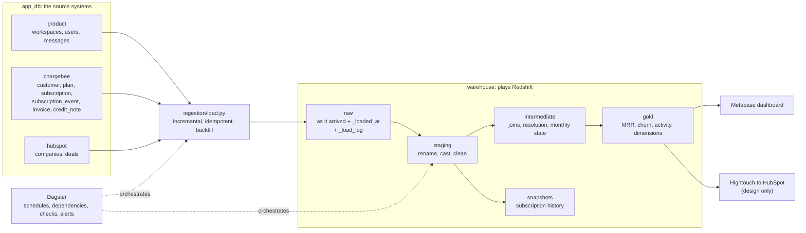

# Architecture

## What each piece does

| Piece | Job | Where |
|---|---|---|
| `app_db` | Plays the source systems. Filled with 18 months of messy fake history. | `sources/` |
| Loader | Copies source tables into `warehouse.raw`. Full load first, then incremental on `updated_at` with a lookback window, replace-by-id so it is idempotent, `--start-date` and `--end-date` for backfills, adds new source columns, writes a run log. | `ingestion/` |
| Reconciliation | Compares row counts and column sums between source and raw. The only check that can see drift from the source. | `ingestion/reconcile.py` |
| dbt | Builds staging, intermediate and gold from raw, plus tests, docs and a snapshot. | `goldmine_dbt/` |
| Dagster | Runs the loader, then dbt, in order, on a schedule, with checks and a failure alert. | `orchestration/` |
| Metabase | Dashboard on the gold tables. | `scripts/metabase_setup.py` |
| Redshift design | Terraform, access control, table design and load SQL for the production shape. Not applied. | `terraform/`, `redshift/` |

## Layers and conventions

| Layer | Rule | Materialization | Naming |
|---|---|---|---|
| raw | Exactly as it arrived. No constraints, so it accepts whatever comes. | tables, written by the loader | `raw.<source>_<table>` |
| staging | One model per source table. Rename, cast, trim, lower-case, guard against repeated rows. No joins, no business logic. | views | `stg_<source>__<table>` |
| intermediate | Joins and business rules across sources. Each model states its grain. | views | `int_<entity>__<detail>` |
| gold | Shaped for consumers. Holds the agreed metric definitions. | tables (one incremental) | `fct_` for facts, `dim_` for dimensions |
| snapshots | History of rows the source overwrites. | snapshot tables | `snap_<source>_<table>` |

Why layers: when a number is wrong you walk backwards, gold logic, then the intermediate join, then staging cleaning, then raw. Each layer narrows the search.

## Grain of every model

| Model | One row per |
|---|---|
| `stg_*` | the same thing as its source table |
| `int_months` | calendar month |
| `int_customers__resolved` | real-world customer (duplicate customer records collapsed) |
| `int_workspaces` | workspace |
| `int_subscriptions__enriched` | subscription |
| `int_subscription_state_monthly` | subscription per month |
| `fct_mrr_monthly` | customer per month |
| `fct_mrr_movements` | customer per month with revenue now or last month |
| `fct_saas_metrics_monthly` | month |
| `fct_workspace_activity_daily` | workspace per active day |
| `fct_active_workspaces_monthly` | month |
| `dim_customers` | resolved customer |
| `dim_workspaces` | workspace |
| `hubspot_company_health` | HubSpot company linked to a paying customer |

## Decisions worth knowing

- **Source freshness reads the loader's run log, not the data.** A quiet table would otherwise look stale while the loader is healthy. The log row is written in the same transaction as the data, so a failed load leaves no log row.
- **History comes from the events log, with a snapshot going forward.** Chargebee overwrites a subscription in place. The events log rebuilds monthly state back to the start, which is how MRR history is computed. The snapshot records the versions seen from its first run on. It cannot see two changes between two runs, the events log can.
- **Business duplicates are resolved in intermediate, not staging.** Staging keeps every row and a `unique` test at warn level keeps the problem visible. Only the intermediate layer can join to subscriptions to choose which customer record survives.
- **Known source defects are warn-level tests with the reason written beside them.** An unexpected regression still fails the build.
- **No dbt packages.** The two generic tests that were needed are in `goldmine_dbt/tests/generic/`.
